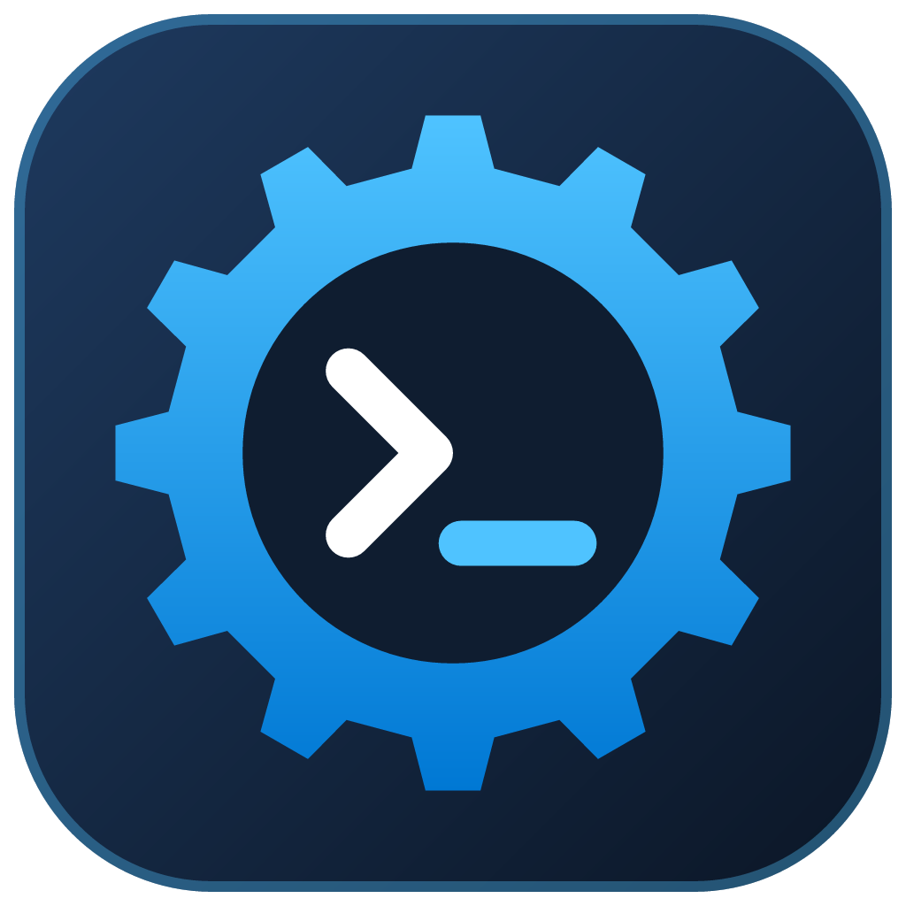
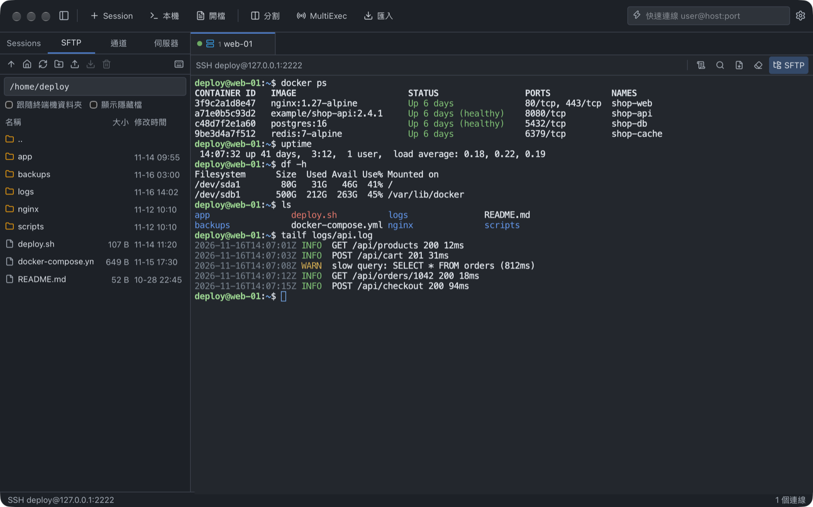
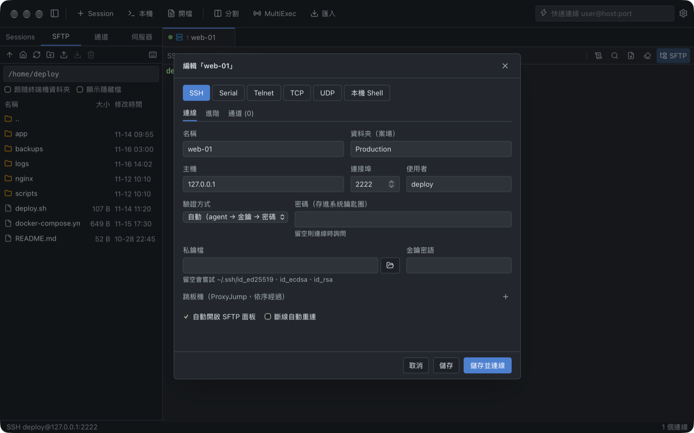
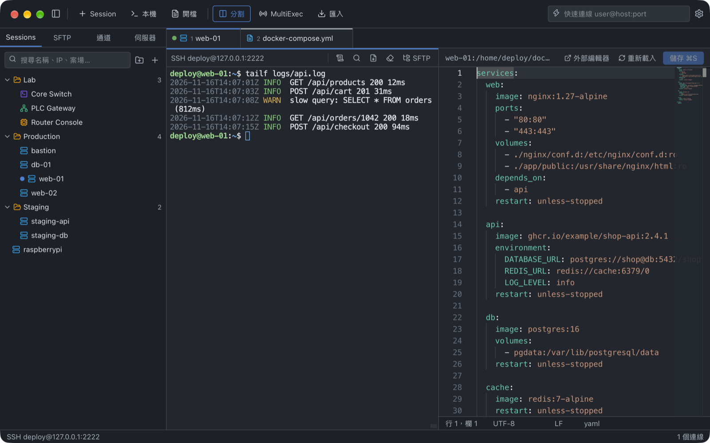

<p align="center"></p>

<h1 align="center">Pinion</h1>

<p align="center">
  給系統整合與現場工程師的跨平台終端工具：SSH、Serial、Telnet、SFTP、通道與臨時伺服器，放在同一個視窗。<br>
  Windows · macOS · Linux ｜ MIT 授權
</p>

<p align="center"><b>繁體中文</b> ｜ <a href="README.en.md">English</a></p>

<p align="center"></p>

---

## 目錄

- [功能](#功能)
- [下載與安裝](#下載與安裝)
- [快速上手](#快速上手)
- [鍵盤快捷鍵](#鍵盤快捷鍵)
- [功能說明](#功能說明)
- [設定與資料存放位置](#設定與資料存放位置)
- [安全設計](#安全設計)
- [從原始碼編譯](#從原始碼編譯)
- [架構](#架構)
- [授權](#授權)

## 功能

| 類別 | 內容 |
| --- | --- |
| SSH | 多分頁、分割畫面；密碼 / 金鑰 / SSH agent；跳板機（ProxyJump，可多層）；keepalive、斷線重連 |
| Serial | 列出 COM 埠並顯示 USB 裝置名稱與晶片（CH340、CP210x、FTDI、PL2303）；HEX 顯示、時間戳記、TX/RX 指示燈；DTR / RTS / BREAK |
| Telnet | 完整 IAC 協商，舊交換器、DDC 控制器可用 |
| TCP / UDP | Client 與 Server 模式；送出 UTF-8 文字、JSON、HEX；收到的 JSON 自動排版上色 |
| 本機 Shell | Windows 為 PowerShell / cmd（ConPTY），macOS / Linux 為預設 shell |
| Session 管理 | 依案場資料夾分組、搜尋、拖曳整理、複製、匯入 / 匯出（不含密碼） |
| SFTP | SSH 連線後左側自動顯示遠端檔案；跟隨終端機目錄；上傳下載（可拖曳）；遠端複製 / 搬移；權限設定；完整鍵盤操作 |
| 文字編輯器 | 內建 VS Code 編輯器核心（Monaco，離線可用）；UTF-8 / Big5、LF / CRLF；存檔前檢查遠端是否被改過並顯示差異；權限不足時用 sudo 存檔；也可改用 VS Code 等外部編輯器（存檔自動上傳） |
| SSH 通道 | Local / Remote / Dynamic（SOCKS5），一鍵開關，可隨 session 自動啟動 |
| 臨時伺服器 | TFTP、HTTP、FTP 一鍵開關，指定資料夾與網卡，預設唯讀、閒置自動關閉（刷韌體用） |
| 其他 | MultiExec（一次送指令到多個分頁）、Session log（檔名含案場與時間）、深色 / 淺色主題、繁體中文 / English 介面、Session 設定檔匯入（.ini / .mxtsessions） |

## 下載與安裝

到 [Releases](https://github.com/ka1hung/pinion/releases) 下載：

| 平台 | 檔案 | 第一次開啟 |
| --- | --- | --- |
| Windows 10 / 11（x64） | `Pinion-<版本>-windows-x64.zip`（免安裝）或 `…-setup.exe` | 尚未簽章，SmartScreen 會警告：按「其他資訊」→「仍要執行」 |
| macOS（Apple Silicon） | `Pinion-<版本>-macos-arm64.zip` | 尚未公證：在 Finder 對 Pinion.app 按右鍵 →「打開」，或執行下方指令 |
| Linux（x64，Ubuntu 24.04+） | `Pinion-<版本>-linux-x64.tar.gz` 或 `.deb` | 需要 GTK4 與 WebKitGTK 6.0 |

用 `SHA256SUMS.txt` 核對下載的檔案：

```bash
sha256sum -c SHA256SUMS.txt --ignore-missing
```

Windows（PowerShell）：

```bash
Get-FileHash .\Pinion-<版本>-windows-x64.zip
```

Windows 若提示缺少 WebView2（Windows 11 已內建）：

```bash
winget install Microsoft.EdgeWebView2Runtime
```

macOS 解除隔離屬性：

```bash
xattr -dr com.apple.quarantine /Applications/Pinion.app
```

Linux 執行期套件：

```bash
sudo apt install libgtk-4-1 libwebkitgtk-6.0-4
```

Linux 使用 Serial 埠需加入 `dialout` 群組（重新登入後生效）：

```bash
sudo usermod -aG dialout "$USER"
```

Linux 上 TFTP 使用 69 埠需要授權（`.deb` 安裝時會自動設定）：

```bash
sudo setcap cap_net_bind_service=+ep /usr/local/bin/Pinion
```

Ubuntu 23.10 以後用 AppArmor 限制一般程式建立 user namespace，Pinion 介面用的 WebKitGTK 沙箱（bubblewrap）會因此無法啟動，打開只看到空白視窗或直接關閉。`.deb` 安裝時會自動放一個只對 Pinion 生效的 AppArmor 設定檔；用 `.tar.gz` 的話，把 `Pinion` 放到 `/usr/local/bin/` 後執行：

```bash
sudo cp apparmor/pinion /etc/apparmor.d/pinion
sudo apparmor_parser -r /etc/apparmor.d/pinion
```

（放在其他路徑的話，先把設定檔裡的 `/usr/local/bin/Pinion` 改成實際路徑。）

## 快速上手

1. **連線**：在右上角「快速連線」輸入 `user@host:port` 後按 Enter；也支援 `telnet://host`、`tcp://host:port`、`udp://host:port`、`COM3`、`/dev/ttyUSB0`。
2. **存成 Session**：按工具列「+ Session」，填好資料並指定資料夾（例如 `台北廠/機房A`），密碼會存進系統鑰匙圈。
3. **檔案**：SSH 連上後左側自動切到 SFTP，雙擊檔案用內建編輯器開啟，Ctrl+S 存回遠端。
4. **從其他工具搬過來**：工具列「匯入」，選擇 session 設定檔（.ini / .mxtsessions），保留資料夾結構。

## 鍵盤快捷鍵

macOS 上把下表的 **Ctrl+Shift** 換成 **⌘**（例如 Ctrl+Shift+T → ⌘T）。

### 全域

| 按鍵 | 功能 |
| --- | --- |
| Ctrl+Shift+T | 開本機終端 |
| Ctrl+Shift+N | 新增 Session |
| Ctrl+Shift+K | 快速連線（搜尋 session 或直接輸入位址） |
| Ctrl+Shift+W | 關閉目前分頁 |
| Ctrl+Tab / Ctrl+Shift+Tab | 下一個 / 上一個分頁 |
| Ctrl+Shift+1 … 9 | 切到第 1～9 個分頁 |
| Ctrl+Shift+B | 顯示 / 隱藏側邊欄 |
| Ctrl+Shift+E | 跳到 SFTP 檔案列表 |
| Ctrl+Shift+, | 設定 |
| 滑鼠中鍵點分頁 | 關閉分頁 |

### 終端機

| 按鍵 | 功能 |
| --- | --- |
| Ctrl+C | 有選取文字時複製；沒有選取時送出中斷（^C） |
| Ctrl+V | 貼上 |
| Ctrl+Shift+C / Ctrl+Shift+V | 複製 / 貼上 |
| Ctrl+Insert / Shift+Insert | 複製 / 貼上 |
| 滑鼠中鍵 | 貼上 |
| 滑鼠右鍵 | 選單（複製、貼上、全選、搜尋、清除）；可在設定改成「有選取就複製，否則貼上」 |
| Ctrl+Shift+F | 搜尋（Enter 下一個、Shift+Enter 上一個、Esc 關閉） |
| R | 連線中斷後按 R 重新連線 |

macOS：⌘C / ⌘V 複製貼上、⌘F 搜尋；Ctrl+C 一律是中斷。

### SFTP 檔案列表

先點一下列表，或按 Ctrl+Shift+E。

| 按鍵 | 功能 |
| --- | --- |
| ↑ ↓ / Home End / PgUp PgDn | 移動 |
| Shift+↑ ↓、Ctrl+點選、Shift+點選 | 多選 |
| Ctrl+A | 全選 |
| Enter / 雙擊 | 開啟資料夾或檔案 |
| Backspace、Alt+↑、`..` | 上一層 |
| Ctrl+C / Ctrl+X / Ctrl+V | 複製 / 剪下 / 貼上（在遠端主機上直接複製或搬移） |
| 拖到資料夾或 `..` | 搬移（按住 Ctrl 為複製） |
| F2 | 重新命名 |
| Delete | 刪除 |
| F5 或 Ctrl+R | 重新整理 |
| F7 或 Ctrl+Shift+N | 新增資料夾 |
| Ctrl+D / Ctrl+U | 下載 / 上傳 |
| Ctrl+Shift+C | 複製路徑 |
| 直接輸入文字 | 跳到該字開頭的檔名 |
| Esc | 回到終端機 |

### 文字編輯器

與 VS Code 相同，常用的有：

| 按鍵 | 功能 |
| --- | --- |
| Ctrl+S | 存檔（寫回遠端或本機） |
| Ctrl+F / Ctrl+H | 搜尋 / 取代（支援正規表達式） |
| Ctrl+D | 選取下一個相同字（多游標） |
| Alt+點選 | 新增游標 |
| Ctrl+/ | 註解 / 取消註解 |
| Ctrl+Z / Ctrl+Y | 復原 / 重做 |
| Ctrl+G | 跳到指定行 |

## 功能說明

### Session 與資料夾

<p align="center"></p>

- 側邊欄「Sessions」依資料夾（案場）分組，可拖曳 session 到其他資料夾，右鍵可新增子資料夾、重新命名、整個資料夾一起連線、匯出。
- 搜尋框可找名稱、IP、資料夾與備註。
- Session 可設定標籤顏色、終端機編碼（舊設備用 Big5）、自動存 log、登入後執行指令。

### SFTP 與編輯器

<p align="center"></p>

- SSH 分頁連上後，側邊欄自動顯示該連線的遠端檔案；切到其他分頁時回到 Sessions（設定中可關閉）。
- 「跟隨終端機資料夾」：在終端機 `cd` 時檔案列表跟著切換（支援 `user@host:~/dir$` 這類提示字元，或會回報目錄的 shell）。
- 從檔案總管把檔案拖進列表即可上傳。
- 右鍵「權限…」以勾選方式設定擁有者 / 群組 / 其他人的讀、寫、執行，也可直接輸入八進位（例如 755）。
- 編輯器存檔前會檢查遠端檔案是否被別人改過，有的話顯示差異讓你決定覆蓋或重新載入；沒有寫入權限時可改用 sudo 存檔。
- 超過大小上限（預設 10 MB）的檔案會詢問是否唯讀開啟。

### Serial 與 TCP / UDP

- 工具列可切換 HEX 顯示、時間戳記；TCP / UDP 另有 JSON 排版。
- 下方送出框可選 UTF-8 / HEX / JSON 格式與結尾字元（CR / LF / CRLF），↑↓ 叫出歷史。
- Serial 可切換 DTR / RTS、送出 BREAK；開埠失敗時會顯示對應平台的處理方式（驅動、權限）。

### SSH 通道

在 SSH session 的「通道」分頁新增規則，再到側邊欄「通道」啟動或停止；勾「自動」則開啟 session 時一併啟動。

| 類型 | 用途 | 範例 |
| --- | --- | --- |
| L 本機轉發 | 在自己電腦開內網設備的服務 | `127.0.0.1:8080` → `192.168.10.5:80`，瀏覽器開 `http://127.0.0.1:8080` |
| R 遠端轉發 | 讓遠端主機連回自己電腦的服務 | 遠端 `127.0.0.1:9000` → 本機 `127.0.0.1:8080` |
| D 動態轉發 | SOCKS5 代理，瀏覽整個內網 | 綁定 `127.0.0.1:1080`，瀏覽器代理設為 SOCKS5 `127.0.0.1:1080` |

綁定位址建議維持 `127.0.0.1`，避免他人透過你的電腦進入客戶內網。

### 臨時伺服器

側邊欄「伺服器」可一鍵開關 TFTP（69）、HTTP（8080）、FTP（2121），指定分享資料夾與網卡；預設唯讀，閒置一段時間自動關閉，傳輸紀錄顯示在下方。第一次啟動時 Windows / macOS 防火牆可能會詢問。

### MultiExec

工具列「MultiExec」開啟後，分頁出現勾選框；在下方輸入指令按 Enter 送到所有勾選的分頁，或勾「同步鍵入」直接在任一分頁打字同步到其他分頁。

### 匯入 Session 設定

工具列「匯入」，選擇其他終端工具的 session 設定檔（`.ini` 或匯出的 `.mxtsessions`）。支援 SSH（含跳板機、金鑰路徑、啟動指令）、Telnet、Serial 與本機 Shell，保留資料夾結構，編碼自動判斷 UTF-8 / Big5；不支援的類型會列出並略過。原檔中的密碼是加密的，不會匯入，第一次連線時輸入並勾選「記住」即可。

## 設定與資料存放位置

| 平台 | 位置 |
| --- | --- |
| Windows | `%APPDATA%\Pinion` |
| macOS | `~/Library/Application Support/Pinion` |
| Linux | `~/.config/Pinion` |

內含 `sessions.json`（不含密碼）、`settings.json`、`known_hosts`。Session log 預設存在 `~/Pinion/logs`，臨時伺服器預設分享 `~/Pinion/share`，都可在設定中更改。

## 安全設計

- **密碼與金鑰密語**存在作業系統憑證庫（Windows 憑證管理員、macOS 鑰匙圈、Linux Secret Service）；Linux 沒有 Secret Service 時改用主密碼加密的檔案（Argon2id + AES-256-GCM）。
- **主機金鑰**強制驗證：首次連線顯示指紋確認，存成 OpenSSH 相容的 `known_hosts`；金鑰變更時一律擋下，可在設定 → Known hosts 刪除舊紀錄。
- **終端資料**走本機 WebSocket：只綁 `127.0.0.1`、隨機埠號、每次啟動產生新的隨機 token。
- **Session log、臨時伺服器預設關閉**；伺服器預設唯讀並禁止跳出分享資料夾。
- **匯出的設定檔不含密碼**。

## 從原始碼編譯

需求：Go 1.26、Node.js 22、Wails CLI v3.1.0；Linux 另需 `libgtk-4-dev libwebkitgtk-6.0-dev pkg-config`。

```bash
go install github.com/wailsapp/wails/v3/cmd/wails3@v3.1.0
```

開發模式（前端熱更新）：

```bash
wails3 dev
```

編譯目前平台（輸出在 `bin/`）：

```bash
wails3 task build
```

執行測試：

```bash
go test ./...
```

發布：推送 `v*` tag，或在 GitHub Actions 的「Release」手動執行並輸入版號，會自動編譯 Windows x64、macOS arm64、Linux x64，附 `SHA256SUMS.txt` 上傳到 GitHub Release。

## 架構

```
React + TypeScript + Tailwind（xterm.js、Monaco）
   │  控制指令：Wails 綁定
   │  終端資料：本機 WebSocket（二進位，每 16ms 合併輸出）
Go 核心
   ├─ Transport 介面：Open / Read / Write / Resize / Close
   │    SSH · Serial · Telnet · 本機 Shell（PTY / ConPTY）· TCP / UDP
   ├─ 分頁管理：重連、Session log、MultiExec、Big5 轉碼
   ├─ SSH 連線池：終端、SFTP、sudo 存檔共用同一條連線
   └─ SFTP · 編輯器 · 通道 · TFTP / HTTP / FTP 伺服器 · 設定檔匯入
本機儲存：sessions.json · settings.json · known_hosts · 系統鑰匙圈
```

所有連線協定實作同一個 `Transport` 介面（`internal/transport`），分頁、log、MultiExec、重連只寫一次；新增協定只需多一個實作。

## 授權

[MIT](LICENSE)。內含的第三方套件授權見 [THIRD_PARTY_NOTICES.txt](THIRD_PARTY_NOTICES.txt)（更新套件後執行 `python3 build/notices/gen_notices.py` 重新產生）。
